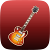
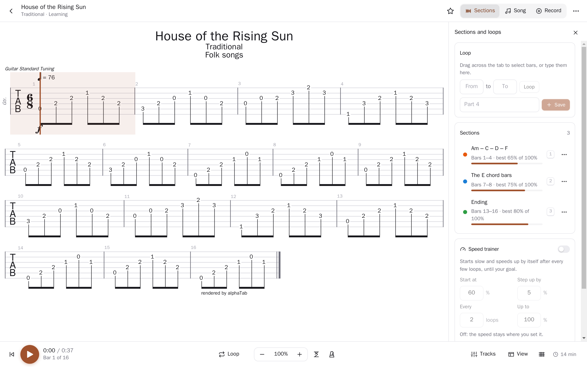
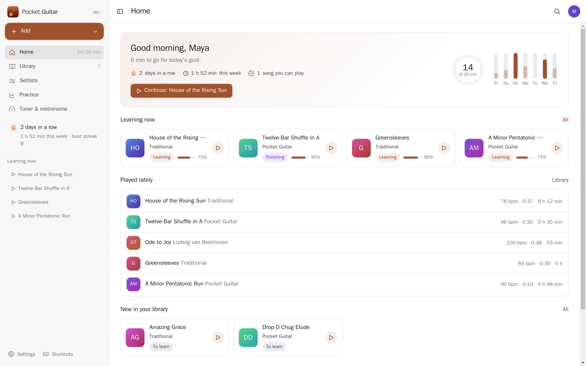
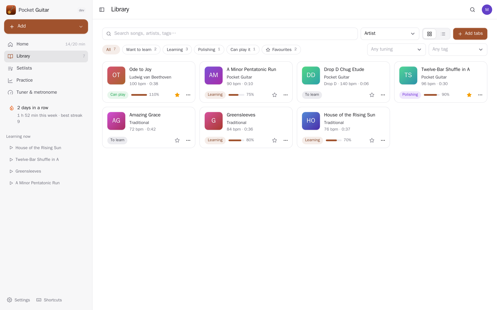
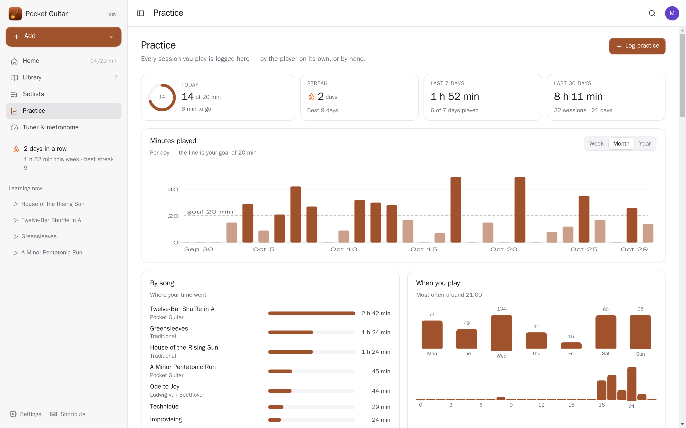
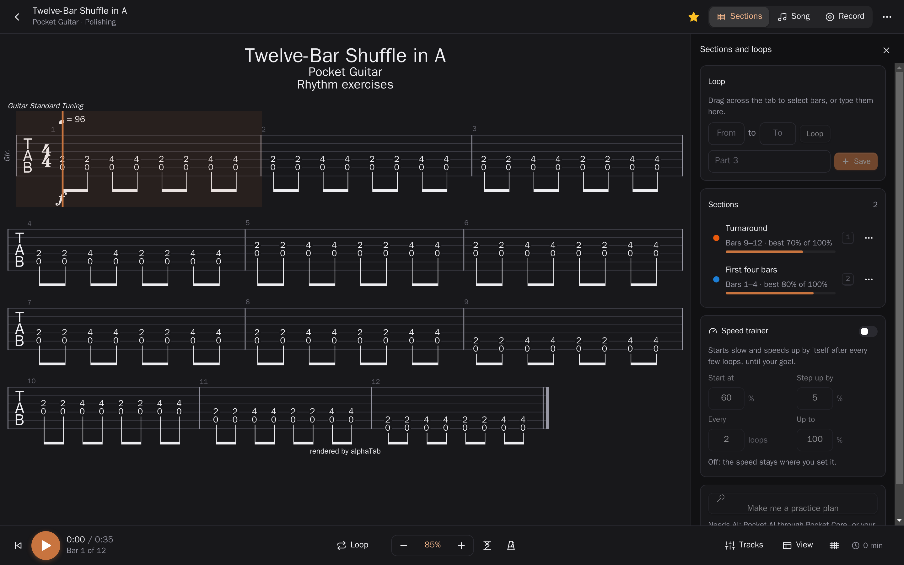
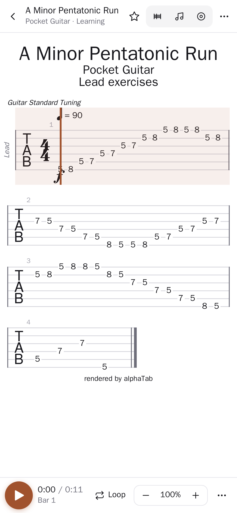
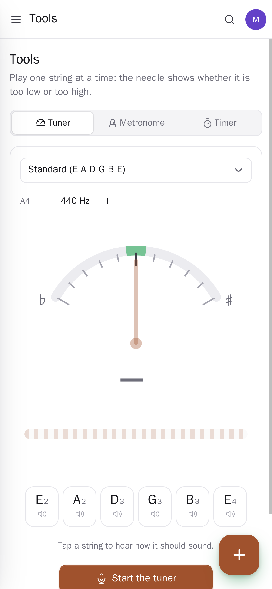

<p align="center"></p>
<h1 align="center">Pocket Guitar</h1>
<p align="center">Your guitar tabs and your practice, on your own server. Open a Guitar Pro, MusicXML or alphaTex file and play along: hear every track, loop the hard bars, let the speed trainer bring them up to tempo, watch the notes on a live fretboard, or play along with the original recording from your Navidrome. Your tabs come from uploads, Songsterr or a folder in Pocket Files that the app keeps an eye on. Every minute you play is logged by itself, with streaks, statistics and a habit ticked in Pocket Habits. A tuner, a metronome and setlists are included.<br>One Go binary, one SQLite file, one volume. Part of the Pocket apps; works on its own too.</p>
<p align="center">
  <a href="https://github.com/abjelosevic88/pocket-homelab-guitar/actions"></a>
  <a href="https://github.com/abjelosevic88/pocket-homelab-guitar/pkgs/container/pocket-homelab-guitar"></a>
  <a href="LICENSE"></a>
</p>

---

<p align="center"></p>

<table>
  <tr>
    <td width="50%"></td>
    <td width="50%"></td>
  </tr>
  <tr>
    <td align="center"><sub>Home: today against your goal, your streak and the songs you are learning.</sub></td>
    <td align="center"><sub>The library: search, filter by where you are with a song, tuning or tag.</sub></td>
  </tr>
  <tr>
    <td width="50%"></td>
    <td width="50%"></td>
  </tr>
  <tr>
    <td align="center"><sub>Practice: logged by the player as you play; minutes, streaks, songs and the year at a glance.</sub></td>
    <td align="center"><sub>Dark mode follows your system, the tab included.</sub></td>
  </tr>
  <tr>
    <td width="50%"></td>
    <td width="50%"></td>
  </tr>
  <tr>
    <td align="center"><sub>On the phone: the same player with a thumb-sized transport bar.</sub></td>
    <td align="center"><sub>The tuner: thirteen tunings, reference tones, calibration.</sub></td>
  </tr>
</table>

## What it does

- **The player** (alphaTab): Guitar Pro 3–8, MusicXML and alphaTex; tab, notes or both; pages or one line; size, display transpose and capo. Playback with every track, a mixer (mute, solo, volume per track), count-in, metronome and 25–200% speed. Click a note to jump there; the page follows the cursor.
- **Loops and sections**: drag across bars to loop them, save them as named sections, jump with 1–9.
- **Speed trainer**: start slow; after a few clean loops it speeds up by itself until your goal, and keeps your best speed per section and per song.
- **Live fretboard** under the tab showing what is being played (left-handed too).
- **Play along with the record**: link a song to its recording in your Navidrome; it plays in sync with the tab at your practice speed, alone or together with the tab's sound.
- **Library**: upload files (drop them anywhere), paste a Songsterr address, or point to folders in Pocket Files: new files appear by themselves, changed ones are read again, deleted ones are marked. Status (want to learn, learning, polishing, can play it), favourites, difficulty, tags, notes, goal speed.
- **Practice log**: every minute you play is saved as you go; add lessons or scales by hand; streaks, a daily goal, minutes per day, time per song, the year heatmap, when you play.
- **Tools**: a tuner with thirteen tunings and reference tones, a metronome with subdivisions, accents and its own speed trainer, a timer for practice without a tab.
- **Setlists**: songs in order; play them one after another.
- **AI practice plan** for a song or a section (Pocket AI or your own OpenAI key), reminders and a weekly report through Apprise, ntfy or a webhook.
- **Everyone their own**: each person has their own songs, practice, settings and connections; admins see no one else's.
- Keyboard throughout: Space play, `[`/`]` speed, `L` loop, `S` save a section, `?` for the rest.

## Run it

```sh
docker run -d --name pocket-guitar -p 8080:8080 -v ./data:/data \
  -e BASE_URL=https://guitar.example.com -e SECURE_COOKIES=true \
  ghcr.io/abjelosevic88/pocket-homelab-guitar:latest
```

or `docker compose up -d` with [docker-compose.yml](docker-compose.yml). Open it, create the first account and drop in your tabs. "From Songsterr" needs a [songsterr-downloader](https://github.com/Metaphysics0/songsterr-downloader) container (`TAB_CONVERTER_URL`). All options: [docs/configuration.md](docs/configuration.md). API: [docs/api.md](docs/api.md). Backups: [docs/backup.md](docs/backup.md).

## With Pocket Core

Set `CORE_URL` and `CORE_REGISTRATION_KEY` and Guitar joins the box: people sign in with Pocket Core, and through app links each person's guitar reaches their own Pocket apps with nothing to paste: their tab folders in Pocket Files (`files:read`, `files:write`), a habit ticked in Pocket Habits when the day's practice is long enough, the original recordings from their own Navidrome login, practice plans from Pocket AI. Other Pocket apps can read your practice (`guitar:read`: Pocket Day's journal, Pocket Calendar) or log practice done elsewhere (`guitar:write`). Events on the bus: `guitar.practice_logged`, `guitar.tab_added`, `guitar.song_mastered`. Without Core every connection can be made directly with a URL and a token; the Core-only choices stay visible, greyed out.

## Develop

```sh
make dev     # API on :8080 with demo data + Vite on :5173
make test    # go vet, go test, tsc
make         # web + binary
```

The demo songs are public-domain melodies and the app's own exercises, written in alphaTex. MIT licensed. The tab rendering and playback come from [alphaTab](https://alphatab.net) (MPL-2.0) with its Sonivox soundfont.
